# UnrealSense — quick guide

UnrealSense adds to Visual Studio (2022 and 2026) help made for Unreal projects: it tells you **where your C++ classes
are used in Blueprints**, suggests `UPROPERTY`/`UFUNCTION` specifiers and warns you about typical Unreal mistakes as you
type. It works with the Unreal Editor closed too.

## Install and update

1. Close Visual Studio.
2. Download `UnrealSense-<version>.vsix` from the [releases](https://github.com/AndreaDecaro/Unreal-Sense/releases) and
   double-click the file.
3. In the window that opens, tick the Visual Studio versions you want it in (2022, 2026) and press **Install**.

To update, do the same with the new file: no need to uninstall.

**Automatic updates**: in Visual Studio open Tools › Options › Environment › Extensions, under *Additional Extension
Galleries* press **Add**, enter a name (UnrealSense) and the URL `https://andreadecaro.github.io/Unreal-Sense/gallery/atom.xml`,
then **Apply**. From then on Visual Studio finds new versions by itself and installs them when you close it. If you had
added the old address `https://assoandrea.github.io/...`, replace it with this one: the old one no longer answers.

If your Visual Studio version is not in the list, put `Install-UnrealSense.ps1` in the same folder as the `.vsix` and
right-click the script › **Run with PowerShell**: it uses the installer of the newest version.

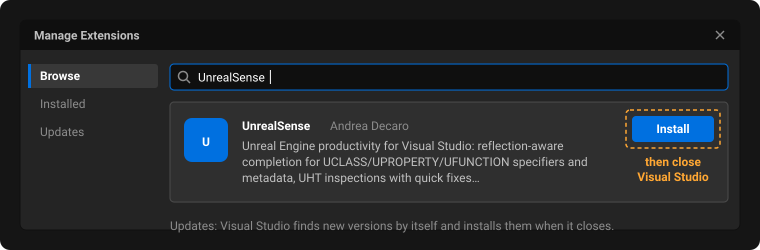

## License

UnrealSense is free. The license (`LICENSE.txt`, shown when you install it) lets the author ask for a paid license key
in the future, also for copies already installed. To know that, about every 12 hours the extension downloads a small
signed public file (`license-policy.json` on the project's GitHub Pages): the request contains nothing about you, your
PC or your projects. A failed check changes nothing, but the extension must reach that file at least once every 48
hours (directly or through the proxy): past that, its features turn off until a check succeeds (the bar has **Check
now**), even with a license key. If a key is ever needed, a bar in Visual Studio will tell you,
with the days left, and the key goes in **Extensions › UnrealSense › License...**. The same file can ask you to update a
version with a security problem: the bar takes you to the new version and, after the stated date, that version stays
off until you update it.

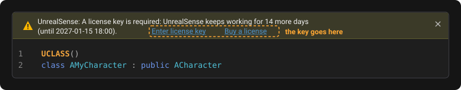
*This bar appears only if a key is ever needed: today UnrealSense is free.*

## First start

Open your project's solution as usual. UnrealSense recognises the project by itself and reads the C++ classes and the
Blueprints in a few seconds (the first time it can take a little longer). From then on everything works automatically.
**View › Output**, *Show output from: UnrealSense*, shows what it is doing.

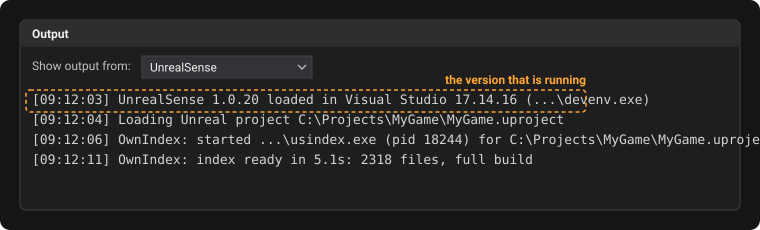

## What you get in the code

### How many Blueprints use a class

Next to classes, functions and properties exposed to Blueprints a grey label appears, for example
`12 derived Blueprints` or `3 Blueprint usages`. **Click it** to see the list of Blueprints.

The count also includes Blueprints that derive from other Blueprints or from child C++ classes (marked "via …").

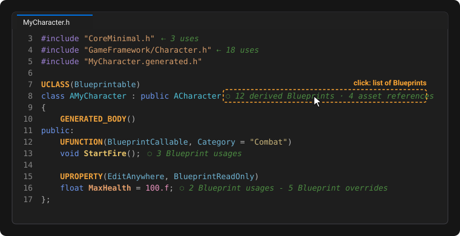

### Find usages in Blueprints

Put the caret on the name of a class, function or property and press **Alt+Shift+B** (or right-click ›
**Find Blueprint Usages**). The **Blueprint Usages** window opens with the list: double-click a row to open the asset in the running Unreal
Editor; the toolbar also has *Show in Explorer* and *Copy reference*.

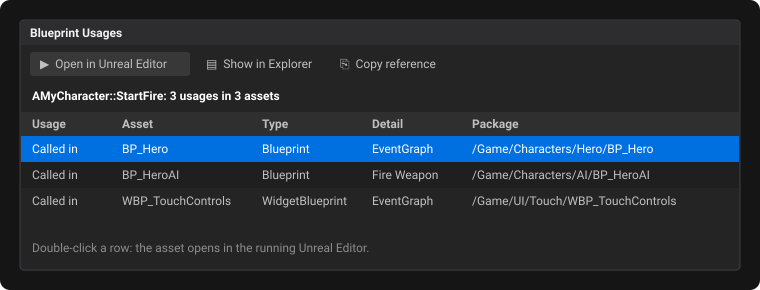

### Search text inside Blueprints

**Extensions › UnrealSense › Search Text in Blueprints...** (or the Quick Menu, Alt+Shift+Q) opens the
**Search in Blueprints** window: type any text (at least 2 characters) and it lists every Blueprint and data asset that
contains it, not only references to classes or variables. If you have text selected in the code, the search starts with
it. For each result you see **what** the text is and **where** it is:

- comment of a comment box or of a single node, with its graph (`EventGraph › comment box`);
- value typed into a node pin (`EventGraph › Call PrintString › pin In String`);
- default value of a variable, or its tooltip/category/display name (`Variable Health › tooltip`);
- text of a widget (`Widget QuitButton › ButtonText`), DataTable row (`Row X › DisplayName`), String Table entry,
  property of a Data Asset or of an actor in a level;
- with the *Names* option, also names of variables, functions, pins and gameplay tags.

For localizable texts (FText) the row tooltip shows namespace and key. Double-click opens the asset in the Unreal Editor;
there are also *Show in Explorer*, *Copy reference* and *Copy text*. Options: *Match case*, *Whole word*, *All assets*
(also searches textures, meshes, sounds and animations, excluded by default) and *Editor caches* (texts the editor
regenerates by itself, such as engine pin tooltips or compiler messages, hidden by default). The search reads the assets
straight from disk (with the editor closed too) and on a project like Lyra takes under a second.

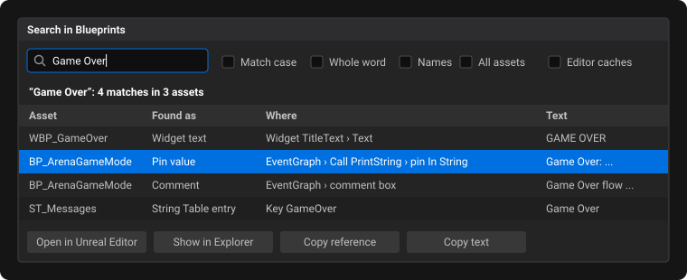

### Information on hover

Hover a specifier (e.g. `BlueprintReadWrite`) to read its explanation, or the name of a class/function/property to see
where it is used in Blueprints.

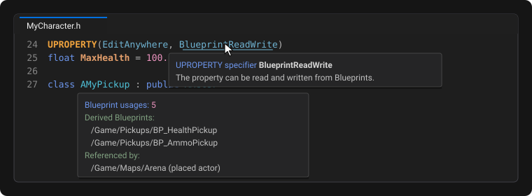

### Suggestions as you type

Inside `UPROPERTY(...)`, `UFUNCTION(...)`, `UCLASS(...)` etc. Visual Studio offers the specifiers valid for your Unreal
version, with their explanation. It works for values too, for example the `Category` names already used in the project
or the function to use in `ReplicatedUsing`.

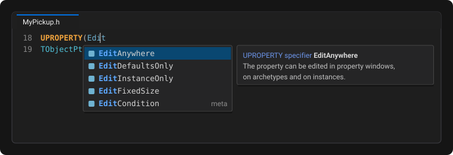

### Member completion (`.` and `->`)

Type a variable name and a dot: Visual Studio lists the functions and variables of its class (including those of the
engine base classes), and the list narrows as you type. It works on local variables, parameters, `this`, call results
(`GetOwner()->`) and members; private and protected members appear only where they are accessible.

- If the variable is a **pointer**, the dot turns into `->` by itself.
- With Unreal pointers (`TObjectPtr`, `TWeakObjectPtr`, `TSharedPtr`, `TUniquePtr`...) the dot stays: the list shows
  both the pointer's functions (`Get`, `IsValid`, `Reset`) and those of the pointed object (marked with `->`); if you
  pick one of the latter the dot becomes `->`.

It also works in engine and plugin files: when you open one, UnrealSense adds it to the index with its headers (a few
seconds). A member just added in a `.h` shows up in the `.cpp` right away, even before you save the header. It uses the
UnrealSense C++ index (see the settings): if you turn it off, there is no completion.

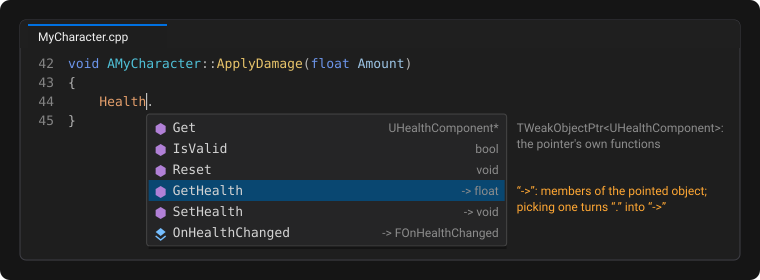

### Name completion (locals, members, types, macros)

Wherever you start typing a name, in `.cpp` and `.h` files (function body, class body, file or namespace level,
parameters, template arguments such as `TArray<TS`, bases `: public AAc`, constructor initializers, field default
values, arguments of `DECLARE_*` macros and of `UE_LOG`), Visual Studio lists, in this order:

- the **parameters** and **local variables** declared so far (inside lambdas too), with their type;
- the **functions, variables and nested types of the class** and of every class it inherits from, with the same access
  rules; in a `static` function only static members;
- the **values of the expected enum** after `case `, `State = `, `State == ` and in the arguments of a function that
  takes an enum (`Name.Find(TEXT("x"), ` offers `ESearchCase::IgnoreCase`), written `EMyState::Value`;
- **types, functions, variables and namespaces** (`TSoftObjectPtr`, `AActor`, `LogLyra`, `NAME_None`, engine enums such
  as `ESearchCase`...), including those declared in the file and not saved yet (for example a delegate just declared
  above) and those created by macros (`GetHealth`/`SetHealth` from `ATTRIBUTE_ACCESSORS`);
- **macros** with their parameters (`UE_LOG`, `DECLARE_DYNAMIC_MULTICAST_DELEGATE_OneParam`, `GENERATED_BODY`...);
- C++ **keywords**.

After `::` it lists the names inside that scope: `UE::Math::`, `EMyEnum::` (the values), `Super::` and `AMyBase::`
(members and nested types); in a `.cpp` outside functions `void AMyActor::` lists all the functions of the class, to
write their definition. After `class ` or `struct ` (forward declaration) it offers class names without selecting any,
so Enter does not replace the name of a new class. Inside `#include "` it offers folders and headers. On a dynamic
delegate the dot also lists `AddDynamic`, `AddUniqueDynamic`, `RemoveDynamic`, `IsAlreadyBound` (or `BindDynamic`).

**Automatic includes**: if you pick a type, function or variable whose header the file does not see (neither directly
nor through other includes), UnrealSense adds the `#include` after the last one (before the `.generated.h`), written as
in Unreal code: relative to the module's `Public`/`Classes`/`Private` folder (`"GameFramework/Actor.h"`) or to the
file's folder; an absolute path only if no include folder contains the header (the suggestion says so). A single
Ctrl+Z removes both name and include. With a forward declaration `class X;` in the file, the include of `X` is not added.

The list does not open while you are declaring something (`FVector Position`), in comments and in strings.
**Ctrl+Space** opens it too.

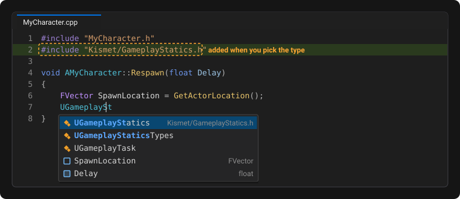

### Warnings and quick fixes

Typical Unreal mistakes are underlined as you type, before compiling: missing or wrong `.generated.h` include, missing
`GENERATED_BODY()`, wrong A/U/F/E/I prefixes, missing `_Implementation`, UObject pointers without `UPROPERTY` or a
smart pointer (the garbage collector does not see them), and more. Generic C++ errors too, only where the types are
certain: writing to a `const` variable, member or object (also inside a `const` method), calling a non-`const` method
on a `const` object, a member that does not exist, the wrong number of arguments, a `private`/`protected` member used
where it is not accessible (friends, derived and nested classes respected); and warnings for `if (A = B)`, `;` right
after `if`/`for`/`while`, `X = X;` and `UE_LOG`/`FString::Printf` with a number of `%` different from the arguments.
When the **light bulb** appears you can apply the fix with a click (for example it creates the `_Implementation` body in
the `.cpp`, or adds `UPROPERTY()` with `TObjectPtr`). Errors are underlined in red, warnings in yellow and suggestions
in blue (colours in *Tools › Options › Fonts and Colors*, entries "UnrealSense - ..."). Errors and warnings are also in
the Error List.

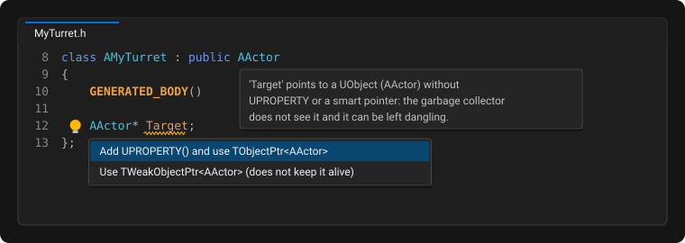

Visual Studio's IntelliSense, on the other hand, reports many errors in Unreal code that do not exist. UnrealSense hides
them (squiggles and Error List) when it recognises them as false:

- **IntelliSense could not configure the file**: it does not open an `#include` of a header that exists (for example
  `E1696` on `"CoreMinimal.h"`) and then underlines the whole file (`UCLASS`, `UPROPERTY`, `DECLARE_...`). Only includes
  that are really missing stay.
- **The `.generated.h` is missing or old** (UHT rebuilds it on the next build): errors on reflection macros, on `Super`,
  `ThisClass`, `StaticClass`, and on `Name_Implementation`, `Name_Validate`, `Execute_Name` when the header declares the
  right UFUNCTION.

Real errors stay. The **IntelliSense errors in Unreal files** option chooses: `HideFalse` (default), `HideAll` (no
IntelliSense errors: UnrealSense warnings and build errors stay) or `ShowAll`.

### Go to definition (Ctrl+click, F12)

**Ctrl+click** a name (or **F12**, or **Alt+G**) in the project's C++ files. If in Tools › Options › Text Editor ›
General you chose another key for "Enable mouse click to perform Go to Definition" (Alt or Ctrl+Alt), that one applies:

- on a function **call** it goes to its implementation in the `.cpp`;
- on the **implementation** it goes to the declaration in the header, and from the declaration to the implementation;
- on a **variable** (member, global, local, parameter) it goes to its declaration;
- on a **type** it goes to the class definition (not to `class AFoo;` declarations).

It also works on code just written and not saved yet. For BlueprintNativeEvent and RPC `UFUNCTION`s it goes to
`_Implementation` (or `_Validate`) and back, from the call too. On names created by a macro (`NAME_None`, `GetHealth`
from `ATTRIBUTE_ACCESSORS`) it goes to the macro line. It uses the UnrealSense C++ index: if that knows nothing there,
Visual Studio's (or Visual Assist's) normal Go To Definition runs. With Alt+G, if the caret is not on a known name, it
switches to the matching file (like Alt+O). If there are several possible targets it opens the first and the status bar
says so.

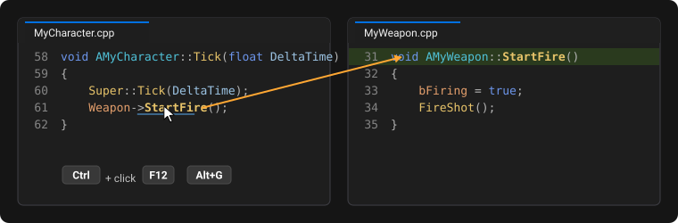

### Code colours

UnrealSense colours the project's C++ files by itself, with its own colours. It does not depend on IntelliSense or
Visual Assist.

**As you type:**
- keywords (also `int32`, `uint8`…), comments and documentation comments (`///`, `/** */`);
- strings (also the path of `#include <…>`), numbers, `#` directives;
- **reflection macros** (`UCLASS`, `UPROPERTY`, `GENERATED_BODY`…) in bold, with their specifiers
  (`BlueprintCallable`), the `meta=(…)` keys in italics and the values.

**From the UnrealSense C++ index**, which also reads unsaved code:
- **UObject types** (`A…`/`U…`, deriving from `UObject`) have a different colour from value types (`FVector`, `TArray`);
- interfaces, enums and their values (also "old style" Unreal enums such as `ESearchCase` and `UE_LOG` verbosity),
  typedefs, namespaces;
- functions, fields, global variables, **locals** and **parameters**, each with its own colour (static ones in italics);
- macros.

Until the index has answered, names are coloured by their Unreal prefix.

Members exposed to Blueprints (BlueprintCallable, BlueprintReadWrite…) are in **bold**.

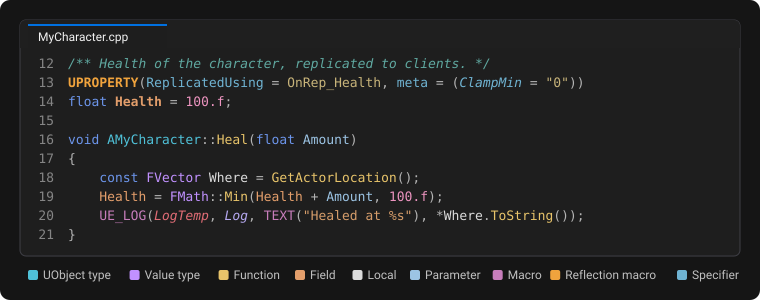

**Changing the colours:** Tools › Options › Environment › Fonts and Colors, entries `UnrealSense - …`. The default
colours follow the theme (dark or light) active when Visual Studio starts.

### Find a symbol or a file (Alt+Shift+T, Ctrl+Shift+T)

**Alt+Shift+T** (Extensions › UnrealSense › **Go to Symbol...**) opens a search window over the classes, functions,
variables, enum values, macros and delegates of the project, its plugins and the engine headers. Typing the initials is
enough (`GAL` finds `GetActorLocation`), or `AFoo::Bar` to search inside a class. **Ctrl+Shift+T** (**Go to File...**)
does the same with files; `File.cpp:120` opens at line 120. In the window **Ctrl+1/2/3/4** (or Tab) switch between
Symbols, Types, Files and In File (the symbols of the open file), **Enter** opens, **Esc** closes. The first time the
project is opened the index builds in a few seconds, then it stays on disk. The *Include engine symbols and files*
option removes the engine from the results.

In every search box (Go to, Unreal Explorer, class hierarchy, Quick Menu, override, module and parent-class lists) the
words separated by spaces are searched each on its own: `shooter char` finds what contains at least one of the two,
first what contains both. The **Fuzzy** box of the Go to window (Ctrl+F, *Fuzzy search* option, on by default) also
accepts scattered letters (`GAL`, `shchar`) and typos (`charcter`); off, every word must appear as written.

**Alt+M** or **Alt+Shift+M** (**Go to Symbol in File...**) opens the same window on the In File tab and searches only the
open file: classes, functions, fields, macros and also local variables and parameters inside functions (with their type
and the function they belong to). With no text it shows the whole file in order, starting from the symbol at the caret;
`Tick::` shows only the locals of `Tick`. Locals come from the UnrealSense C++ index: if it is off or still building,
the bar at the bottom says so and the list shows only declarations.

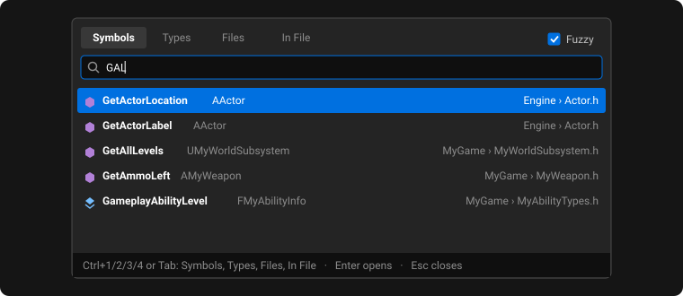

### All commands in one menu (Alt+Shift+Q)

Press **Alt+Shift+Q** (or Extensions › UnrealSense › **Quick Menu**): a menu opens where the mouse is, with all the
UnrealSense commands grouped into search, code, project and tools, each with its shortcut. The commands still act on the
text caret: at the top, in small print, the menu shows the name it is on (*At caret: ...*). Type to filter the commands,
pick with the arrows and press **Enter**; **Esc** closes. The menu shows only the commands that make sense where the
caret is: for example **Declare Delegate...** only in a header, outside function bodies, comments and strings;
**Create Implementation** only on a declaration that has no body yet; **Add Forward Declaration** only on a type in a
header; **GoTo Implementation/Declaration** only on a function name. The shortcuts and the Extensions › UnrealSense menu
work everywhere and, in the wrong place, the status bar explains why.

The UnrealSense windows (Unreal Explorer, Find Usages, Blueprint Usages, Go to Symbol/File, Quick Menu and the New
Unreal Class, Override and Declare Delegate dialogs) have two themes, from **Tools › Options › UnrealSense › General ›
UI theme**: **Unreal** (default, the Unreal Engine 5 editor style, the same with every Visual Studio theme) or
**Classic** (Visual Studio's colours, font and title bars, following the dark, light, blue or custom theme right away).
Open windows switch theme when you save the options.

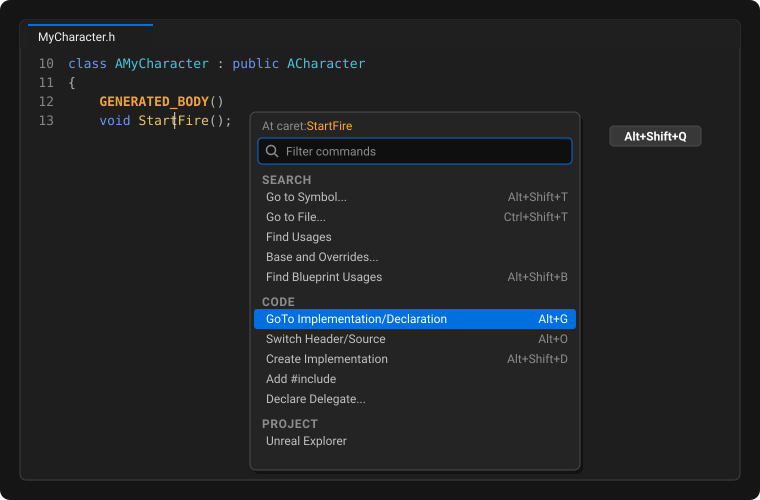

### Switch between .h and .cpp

Press **Alt+O** (or right-click › **Switch Header/Source**) to open the `.cpp` of the header you are looking at, or the
header of the `.cpp`. It follows the Unreal module layout (`Public\Ui\Menu.h` ⇄ `Private\Ui\Menu.cpp`, also `Classes`)
and works in engine and plugin files too. If the matching file does not exist, the status bar at the bottom says so.

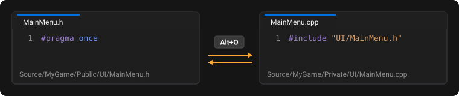

### Override virtual functions

With the caret inside a class (in the `.h`, or in one of its functions in the `.cpp`) press **Alt+Shift+V** (or
right-click › **Override Virtual Functions...**): the list of virtual functions the class inherits opens (from the
engine, plugins, the project and interfaces). Tick the ones you want: UnrealSense adds the declarations in the `.h` and,
if you leave it ticked, definitions calling `Super::` in the `.cpp`. Engine classes load in the background when you open
the project; if you press Alt+Shift+V right after, the status bar says they are loading.

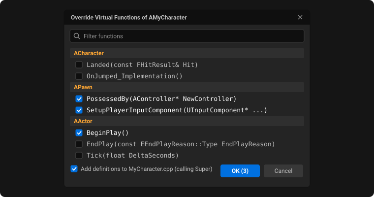

### Create a function's implementation (Create Implementation)

Write the declaration in the `.h`, leave the caret on the line (also on the `UFUNCTION(...)` line) and press
**Alt+Shift+D**, or `Ctrl+.` › **Create implementation of ...** (the light bulb appears only if the definition does not
exist yet). UnrealSense writes the body in the `.cpp` next to the definitions of the functions declared before or
after, inside the same `#if`, and moves the caret there. Selecting several declarations creates them all. It follows
Unreal's rules:

- `BlueprintNativeEvent` and `Server`/`Client`/`NetMulticast` RPCs become `Name_Implementation`; with `WithValidation`
  it also adds `bool Name_Validate(...)` returning `true`;
- an override calls the parent version (`Super::Name(...)`, with `return` if it returns a value) only if an ancestor
  really implements it (not for interfaces or pure functions);
- a constructor with `const FObjectInitializer&` gets `: Super(ObjectInitializer)`;
- `BlueprintImplementableEvent`, pure and inline functions and interface events have no definition: the status bar
  explains why. If the definition already exists, the caret goes there.

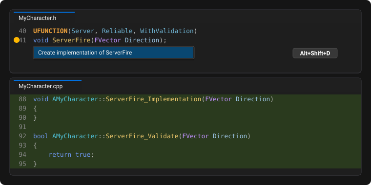

### Declare a delegate

Put the caret in the header where you want the member (usually an empty line in the class's `public:` section) and open
**Alt+Shift+Q › Declare Delegate...** (or Extensions › UnrealSense › **Declare Delegate...**). In the panel choose:

- the **kind**: Single, Multicast, Dynamic, Dynamic Multicast, Sparse or Event (Sparse and Event only with the caret
  inside the owning class);
- the **name** (`OnScoreChanged`) and the delegate **type**, which follows the name (`FOnScoreChangedSignature`) until
  you change it;
- the **return type**, only for Single and Dynamic (the others cannot return values);
- up to nine **parameters** (type and name; for dynamic delegates the name is required);
- whether to also declare the **member** and the **handler signature** to bind.

The preview shows the code as you type and warns about errors Unreal would give (for example a comma in a type such as
`TMap<int32, FString>`, which breaks the macro). **Create** writes the right `DECLARE_..._DELEGATE...` macro after the
`#include`s, above the class, and the member at the caret (`UPROPERTY(BlueprintAssignable)` for dynamic multicast and
sparse; for an Event the macro, a public accessor and the private field inside the class); a single Ctrl+Z undoes it
all. **Copy** copies the same code to the clipboard without touching the file. Under the preview a note explains what
the chosen kind is for, and **Usage example** expands with an example of how to bind, call and unbind it, written with
your delegate's names.

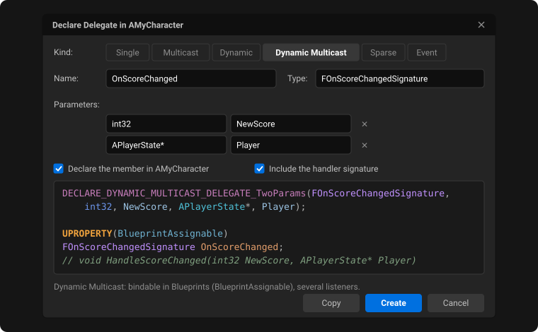

### Class hierarchy

With the caret on the name of a class or struct open **Alt+Shift+Q › Class Hierarchy...** (or Extensions › UnrealSense ›
**Class Hierarchy...**; the entry appears only on a class name). A drop-down opens where the mouse is, with the class,
its **base classes** from the nearest (for example `ACharacter`, `APawn`, `AActor`, `UObject`, interfaces included) and
the **derived classes** as a tree, with level lines and, next to each class, how many subclasses it has. Classes with
subclasses collapse and expand with a click on the arrow or with **←/→** (**Ctrl+←/→** all of them); with more than 40
derived classes only the first level is open at the start. Clicking one (or up/down arrows and **Enter**) opens its file
at the class; typing filters the list (matching classes stay under their parents).

Engine classes come from the UnrealSense C++ index, which knows the engine headers included by the project: bases are
always complete, engine derived classes are those of those headers (all of them with *Index the whole engine*). Derived
classes of very common classes such as `UObject` stop at 2,000. While the index builds, only the project's
UCLASS/USTRUCT classes appear.

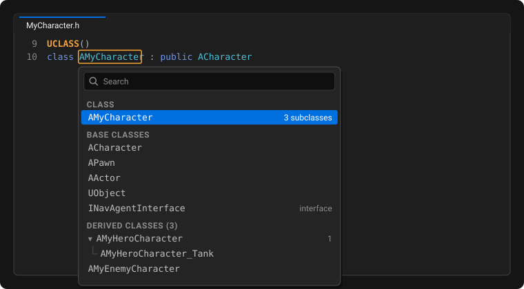

### Base function and overrides

With the caret on a `virtual` function, an `override` or a `UFUNCTION` event, the Quick Menu shows
**Base and Overrides of X...** in place of *Class Hierarchy...*. While the drop-down is open, the name it refers to
(class or function) is highlighted in orange in the editor. The drop-down lists the function, the **base functions** it
overrides up to the one that introduces it (marked *origin*, for example `AActor::BeginPlay`) and the **overrides** in
subclasses, as a tree. A `BlueprintNativeEvent` is followed through its `_Implementation`s: from the caret on
`ChoosePlayerStart` you see its implementation and the subclasses' `ChoosePlayerStart_Implementation`, and from one of
those you get back to the `UFUNCTION`. For events the **Blueprints implementing them** appear too; on a
`BlueprintImplementableEvent` the entry is called **Blueprint Implementations of X...**. Clicking a function opens its
file, clicking a Blueprint opens it in the Unreal Editor. It needs the UnrealSense C++ index.

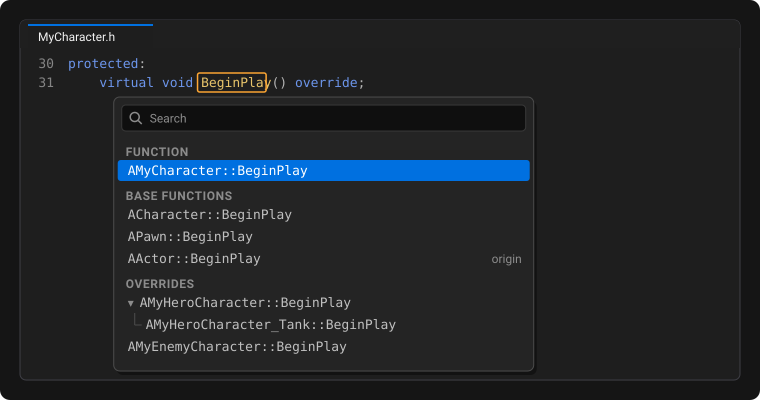

### Add an #include or a forward declaration

With the caret on a name open **Alt+Shift+Q › Add #include**: UnrealSense adds the `#include` of its header written as
in Unreal code (`"GameFramework/Actor.h"`), after the other includes and before the `.generated.h`. For a class, struct
or enum it is its header; for a variable or function the header declaring it if the file does not see it yet, otherwise
the one of its type (`TObjectPtr<UMyComponent> Comp` → the header of `UMyComponent`).

In a header **Add Forward Declaration** appears too: it writes `class UMyComponent;` (or `struct`,
`enum class EMode : uint8;`, inside its namespace) after the includes or next to the other forward declarations.
Templates, nested classes and enums without an underlying type cannot be declared this way: the status bar says so. It
needs the UnrealSense C++ index.

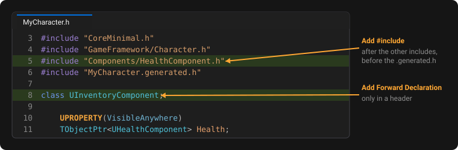

### Unreal Explorer

Menu **Extensions › UnrealSense › Unreal Explorer** (or **View › Other Windows**). It shows the project's modules, the
plugins, the Blueprints grouped by their C++ parent class and the config files, with a search box.

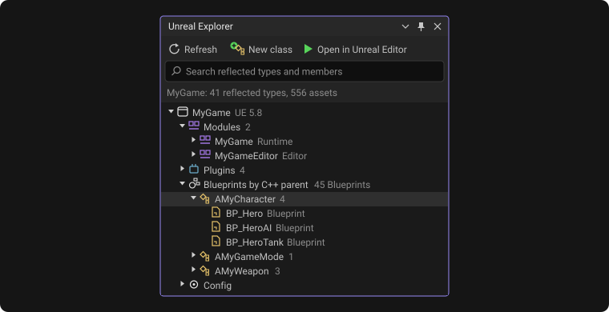

### Create a new Unreal class

In Solution Explorer right-click a project or a folder › **Add › Unreal Class...** (or
**Extensions › UnrealSense › Unreal Class...**, or the **New class** button of the Unreal Explorer). Choose:

- the class **name** (UnrealSense adds the `A`, `U`, `F`, `E` prefix);
- the **parent class**: **Common** has the most used ones (Actor, Character, Actor Component, Interface, Struct, Enum,
  Empty, subsystem, User Widget...), **All Classes** every class of the project, its plugins and the engine (the first
  time the list fills after a few seconds);
- the **folder**: Public puts the `.h` in `Public` and the `.cpp` in `Private`.

The path can be in any module (a folder with a `.Build.cs`, or below it): the project, its plugins, the engine or engine
plugins. It starts from the folder of the file open in the editor (or the one selected in Solution Explorer); the
**...** button opens a picker with the project, plugin and engine source folders as a tree, with modules and plugins
marked, and a search by module name.

UnrealSense creates the files like the Unreal Editor does (with `<MODULE>_API`, the right includes and the parent's
typical functions, for example `BeginPlay` and `Tick` for an Actor), adds them to the project and opens them. Structs
and enums have only the `.h`. If the module does not depend on the parent class's module (for example `UMG` for a User
Widget), a checkbox offers to add it to the `.Build.cs`.

The new files' includes stay underlined in red until you run **Generate Project Files**: it is a limit of the projects
Unreal generates, building works anyway. The `.generated.h` file exists only after the first build.

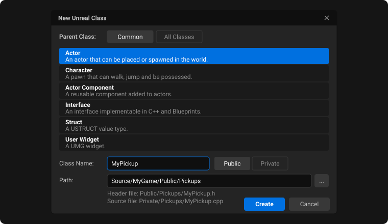

## Settings

**Tools › Options › UnrealSense**. In Visual Studio 2026 it is a page of the new settings window (*All Settings ›
UnrealSense*, split into sections, with the values you already had); in Visual Studio 2022 it stays the classic page.
The most useful ones:

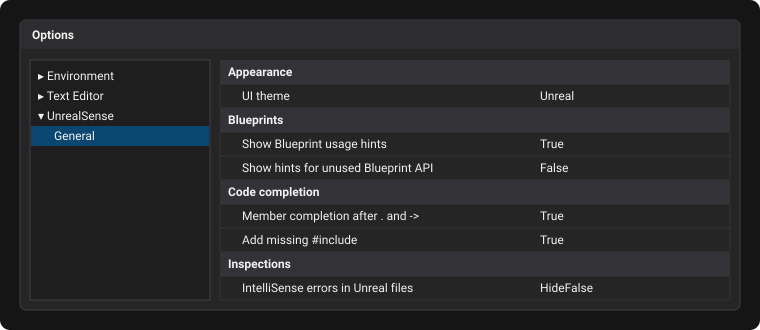

- **Show Blueprint usage hints**: turns the grey labels in the code on/off.
- **Show hints for unused Blueprint API**: also shows "no Blueprint usages" on functions and properties exposed to
  Blueprints but never used (useful for cleaning up).
- **Unreal project**: set it only if UnrealSense opens the wrong project (it happens with solutions containing more than
  one).
- **IntelliSense errors in Unreal files** (*Inspections* section): `HideFalse` by default hides IntelliSense's false
  errors; `HideAll` hides them all; `ShowAll` keeps Visual Studio's.
- **Member completion after . and ->** (*Code completion* section): on by default; turns off only member completion.
- **Name completion (locals, members, types, macros)** (*Code completion* section): on by default; turns off name
  completion as you type, after `::` and inside `#include`.
- **Add missing #include** (*Code completion* section): on by default; off, picking a name does not add the missing
  include.
- **Don't wait for Visual Studio's C++ list** (*Code completion* section): on by default; where UnrealSense offers names
  it does not ask for IntelliSense's list, so the list appears as soon as our index answers instead of waiting for
  IntelliSense (slow after a header change or with many projects loaded). Where our index has nothing, Visual Studio's
  list opens. Off, the list merges the two again (and waits for IntelliSense). Visual Assist is unaffected.
- **UI theme**: `Unreal` by default (Unreal Editor style); `Classic` uses Visual Studio's colours and follows its theme.
- **UnrealSense colorization** and **Semantic colours from the own index** (*Colorization* section): on by default.
  - The first turns off all UnrealSense colours (Visual Studio's come back): it applies to open files right away, as soon
    as you press OK.
  - The second keeps only the colours that do not come from the index: tokens and Unreal prefixes.
- **Go to definition (Ctrl+click, F12)** (*Find Usages (own index)* section): on by default; off, Ctrl+click and F12 go
  back to Visual Studio.
- **Use the own C++ index** (*Find Usages (own index)* section): on by default. Member and local variable completion
  need it (off, there is no completion) and it turns on **Find Usages** (editor context menu and Extensions ›
  UnrealSense): it finds where a C++ symbol is used with an index of our own, without clangd, also inside macros
  (arguments of `UE_LOG`/`check`/`AddDynamic`, body of a project `#define`, `UPROPERTY(ReplicatedUsing = OnRep_X)`). The
  first time it takes a few seconds; then the index stays on disk and after every save of a C++ file it rereads only the
  changed files (if you did not add or remove declarations it reuses the known symbols: with Lyra and the whole engine
  about 1 second, about 4 if a declaration changes). *Index the whole engine* (on by default) adds all the engine
  sources (about 100,000 files); if you turn it off only the engine headers included by the project are indexed. In Task
  Manager it shows up as `usindex`: during a build it uses more memory, then gives it back (for a project like Lyra
  about 0.3 GB; with the whole engine about 3.5 GB in Task Manager, more with a bigger engine). Its log lines start with
  `OwnIndex:`.

## If something goes wrong

- **I don't see the counters**: wait a few seconds after the solution opens. If you have just saved Blueprints in
  Unreal, use **Extensions › UnrealSense › Rebuild UnrealSense Index**.
- **A counter looks wrong**: note the class and a Blueprint that uses it, and send the log file (below).
- **Visual Studio's "Find All References" no longer works**: if the Extensions › UnrealSense menu shows
  **Restore Visual Studio Indexing**, run it and restart Visual Studio.
- **A shortcut (Alt+Shift+B, I, V, K, M) does nothing or something else**: another extension uses the same key. In the
  log the `KeyBindingCheck:` line says which command uses it; you can change the key in **Tools › Options › Environment ›
  Keyboard** by searching for `UnrealSense.`.
- **Log to attach to a report**: the `%LOCALAPPDATA%\UnrealSense\Logs` folder (paste the path into File Explorer's
  address bar) has one file per Visual Studio session, `UnrealSense_<date>_<time>_pid<id>.log`: attach the one of the
  session with the problem (usually the newest). The last five sessions are kept. The current session's log is also
  visible in Visual Studio under **Output › UnrealSense**.
- **Visual Studio freezes or closes by itself**: also attach `Hangs_<date>_<time>_pid<id>.log` of the same session: for
  freezes of 5 seconds or more it also contains the UI thread's stack, which shows where Visual Studio is stuck even when
  UnrealSense is not to blame. It says whether the freeze was in UnrealSense code and, with the `WHOLE PROCESS STALLED`
  line, whether the whole process stopped (usually memory: every line reports Visual Studio's memory and the PC's free
  memory).

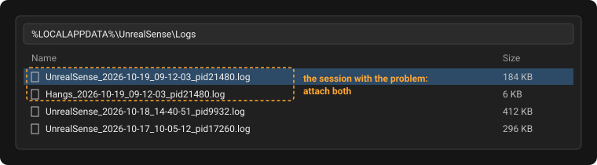
